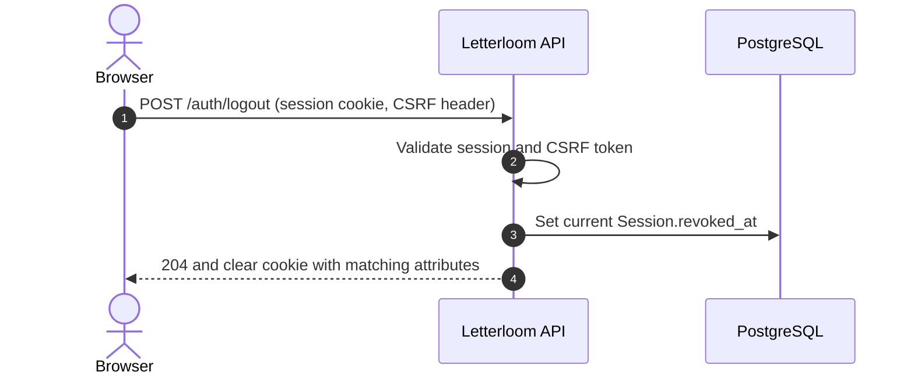

# Letterloom Authentication Flows

**Status:** Proposed flows based on the Phase 3.1 confirmed requirements. No flow is implemented yet. Labels use the Confirmed / Recommended / Pending approval legend in [`authentication-v1.md`](authentication-v1.md).

## Email/password registration

**Confirmed:** registration is compulsory; an email/password account is not usable until its email is verified. **Recommended:** return the same public response for new and already-registered addresses so registration does not become an account-enumeration endpoint.

```mermaid
sequenceDiagram
    autonumber
    actor Browser
    participant API as Letterloom API
    participant DB as PostgreSQL
    participant Mail as Email delivery adapter

    Browser->>API: POST /auth/register (email, password, display_name)
    API->>API: Validate input, canonicalize email, hash password with Argon2id
    API->>DB: Transaction: create unverified User and one_time_token digest
    alt New address
        DB-->>API: User and token record committed
        API->>Mail: Send verification link (raw token only in link)
    else Address already exists
        API->>API: Do not overwrite password or disclose account status
    end
    API-->>Browser: 202 Accepted; generic next-step message
```

The browser may show the verification screen after registration. Do not issue a product session yet. If a matching unverified account already exists, use the resend flow rather than changing its password.

## Email verification

The link carries a random token over HTTPS. Do not put it in logs or analytics. The server hashes the submitted token, checks purpose and expiry, and consumes it atomically with the update to `email_verified_at`.

```mermaid
sequenceDiagram
    autonumber
    actor Browser
    participant API as Letterloom API
    participant DB as PostgreSQL

    Browser->>API: POST /auth/email/verify (token)
    API->>API: Hash submitted token
    API->>DB: Transaction: consume matching token and set User.email_verified_at
    alt Token valid and unused
        DB-->>API: One token consumed; user marked verified
        API-->>Browser: 204; show verified screen
    else Expired, wrong-purpose, or already consumed
        API-->>Browser: Generic invalid/expired link response
    end
```

The verification screen and resend endpoint are the only account functions available before verification. Resend requests must not reveal whether an address exists.

## Password login

```mermaid
sequenceDiagram
    autonumber
    actor Browser
    participant API as Letterloom API
    participant DB as PostgreSQL

    Browser->>API: POST /auth/login (email, password)
    API->>DB: Find user by canonical email
    API->>API: Verify Argon2id hash; use dummy hash path for unknown user
    alt Credentials invalid
        API-->>Browser: Generic 401 response
    else Password valid, email not verified
        API-->>Browser: 403 verification_required; no product session
    else Password valid and email verified
        API->>DB: Create server-side Session (idle and absolute expiry)
        API-->>Browser: 200 plus HttpOnly session cookie and CSRF token
    end
```

The cookie contains an opaque random session secret; the database stores its digest. Only verified accounts receive a session usable on product routes. Apply rate limits by both source and account identifier without permanently locking an account in a way that lets an attacker deny service.

## Google login and automatic registration

**Confirmed:** use the Authorization Code flow and automatically create an account the first time a trusted Google identity signs in. **Recommended:** use OIDC with PKCE `S256`; bind one-use `state`, `nonce`, and the PKCE verifier to that browser's transaction.

```mermaid
sequenceDiagram
    autonumber
    actor Browser
    participant API as Letterloom API
    participant Google
    participant DB as PostgreSQL

    Browser->>API: GET /auth/google/start
    API->>API: Create one-use state, nonce, PKCE verifier
    API-->>Browser: 302 to Google authorization endpoint
    Browser->>Google: Authorization Code request (state, nonce, S256 challenge)
    Google-->>Browser: Redirect to callback (code, state)
    Browser->>API: GET /auth/google/callback (code, state)
    API->>API: Validate state; exchange code server-to-server
    API->>API: Validate ID-token signature, iss, aud, exp, nonce, sub, email claims
    API->>DB: Find OAuthIdentity by (google, sub)
    alt Identity already linked
        DB-->>API: Linked User
        API->>DB: Create Session
        API-->>Browser: Set session cookie; redirect to app
    else New identity, no email conflict
        API->>DB: Transaction: create User and OAuthIdentity
        Note over API,DB: Set email_verified_at only when the claim meets the approved trust rule
        API->>DB: Create Session only if email verification is satisfied
        API-->>Browser: Set cookie or show verification screen
    else Email matches a different existing account
        API-->>Browser: Generic account-link conflict; do not link by email
    end
```

If the identity is new but its verified email matches an existing account, require the user to sign in through that account's existing method and start an explicit Google-link flow from an authenticated, recently reauthenticated session. Never attach the identity automatically. If Google says `email_verified=true` but the claim does not meet the approved trust policy, the new account may be created but remains limited until Letterloom verifies the email.

**Pending approval:** define which Google email claims are trusted. Google documents that a Gmail address or a verified Workspace address with `hd` is authoritative; a third-party address without `hd` may no longer be controlled by the Google account.

## Password recovery

```mermaid
sequenceDiagram
    autonumber
    actor Browser
    participant API as Letterloom API
    participant DB as PostgreSQL
    participant Mail as Email delivery adapter

    Browser->>API: POST /auth/password-reset/request (email)
    API->>DB: Find eligible verified password account
    alt Eligible password account
        API->>DB: Store digest of random password_reset token
        API->>Mail: Send HTTPS reset link
    else Unknown, unverified, or Google-only account
        API->>API: Do not disclose account or login method
    end
    API-->>Browser: 202 generic response
    Browser->>API: POST /auth/password-reset/complete (token, new_password)
    API->>DB: Atomically consume one valid password_reset token
    alt Token valid
        API->>API: Hash new password with Argon2id
        API->>DB: Update password_hash; consume other reset tokens; revoke all sessions
        API-->>Browser: 204; require normal login
    else Invalid, expired, or consumed token
        API-->>Browser: Generic invalid/expired link response
    end
```

Password reset does not automatically create a session. A Google-only user has `password_hash = NULL`; the reset endpoint must not silently create a password login method. Password setup for such a user should be an explicit authenticated account-security flow and remains pending product approval.

## Logout



The endpoint should be idempotent from the browser's perspective: clear the cookie even if the server session is already expired or revoked. Cookie clearing alone is not the revocation step.

## Account deletion

```mermaid
sequenceDiagram
    autonumber
    actor Browser
    participant API as Letterloom API
    participant DB as PostgreSQL
    participant Files as Object storage / deletion worker

    Browser->>API: DELETE /auth/account (session, CSRF, recent reauthentication)
    API->>DB: Mark deletion requested; revoke all sessions and outstanding tokens
    API-->>Browser: 202 deletion pending; clear cookie
    API->>DB: Read attachment storage keys for owned letters
    API->>Files: Delete objects idempotently; retry failures
    alt All stored files are deleted
        API->>DB: Delete User in transaction
        Note over DB: Cascades delete OAuth identities, sessions, tokens, letters, attachments and reflections
    else Storage deletion failed
        API->>DB: Keep deletion pending and inaccessible; retry asynchronously
    end
```

**Recommended:** the initial response is `202 Accepted`; completion happens asynchronously and is not sent over the already-ended HTTP response. Do not claim permanent deletion while external files remain. Keep the user inaccessible and sessions revoked while retrying file deletion. Decide whether the user needs a separate status or notification flow when the storage and worker design is selected. The Phase 2 repository has no physical file store or worker, so the operational retry mechanism depends on that later choice.

## References

- [Mermaid sequence diagram syntax](https://mermaid.js.org/syntax/sequenceDiagram)
- [Google OpenID Connect](https://developers.google.com/identity/openid-connect/openid-connect)
- [RFC 9700 OAuth 2.0 Security Best Current Practice](https://www.rfc-editor.org/rfc/rfc9700.html)
